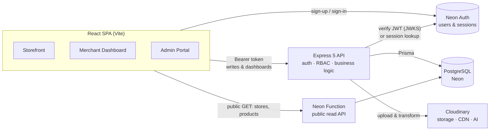
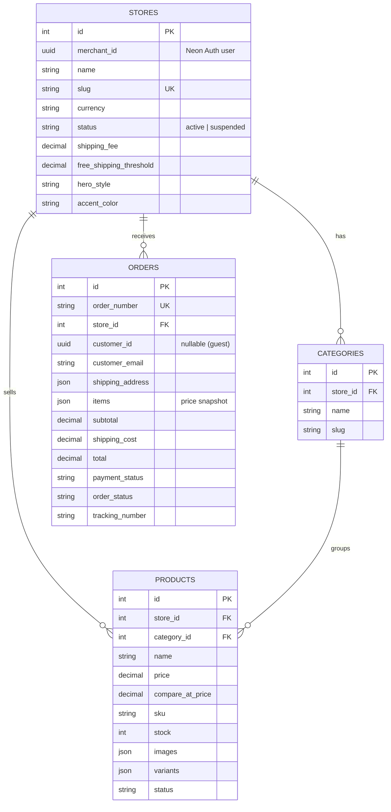

<div align="center">

# 🛍️ Orbivo — Multi-Tenant E-Commerce Platform

**Launch, brand and manage online stores from a single platform.**
Merchants get their own storefront and dashboard, customers get a fast checkout, and platform admins keep everything moderated.


[Live Demo](#) · [Report a Bug](https://github.com/Ayush-verma25/Orbivo-E-Commerce-Platform-App/issues) · [Request a Feature](https://github.com/Ayush-verma25/Orbivo-E-Commerce-Platform-App/issues)

</div>

---

## 📑 Table of Contents

- [About the Project](#-about-the-project)
- [Key Features](#-key-features)
- [Tech Stack](#-tech-stack)
- [System Architecture](#-system-architecture)
- [Database Design](#-database-design)
- [Roles & Permissions](#-roles--permissions)
- [How Checkout Works](#-how-checkout-works)
- [AI-Powered Product Imagery](#-ai-powered-product-imagery)
- [Security Highlights](#-security-highlights)
- [Project Structure](#-project-structure)
- [Getting Started](#-getting-started)
- [Environment Variables](#-environment-variables)
- [API Reference](#-api-reference)
- [Deployment](#-deployment)
- [Roadmap](#-roadmap)
- [Contributing](#-contributing)
- [License & Acknowledgements](#-license--acknowledgements)
- [Author](#-author)

---

## 📖 About the Project

**Orbivo** is a full-stack, **multi-tenant e-commerce platform** built on the PERN stack (PostgreSQL, Express, React, Node.js) with TypeScript end to end. Think of it as a lightweight "Shopify-style" system: any merchant can register, create a store under its own URL (`/store/<slug>`), customise its look, publish products, and start taking orders — while a platform administrator oversees every store and merchant.

The project is split into three experiences that share a single backend:

| Experience | Who it's for | What it does |
| --- | --- | --- |
| 🛒 **Storefront** | Shoppers | Browse a store, view products, build a cart, check out as guest or signed-in customer, track orders |
| 🏪 **Merchant Dashboard** | Store owners | Onboard a store, manage products / categories / orders, view analytics, brand the storefront |
| 🛡️ **Admin Portal** | Platform operators | See platform-wide metrics, review and suspend/activate stores, browse merchants |

<!--
📸 SCREENSHOTS — add your own images to a /docs folder and uncomment:

| Landing Page | Storefront | Merchant Dashboard |
| --- | --- | --- |
|  |  |  |
-->

---

## ✨ Key Features

### 🛒 Customer Storefront
- **Tenant-isolated stores** served at `/store/:storeSlug`, each with its own catalog, branding and shipping rules
- **Themeable storefronts** — 4 hero layouts (`hero1`–`hero4`) and 10 accent-colour presets chosen by the merchant
- **Catalog browsing** with search (URL-synced), category filtering and sorting (price, name, newest)
- **Product detail pages** with image gallery, variant selection (e.g. Size / Colour), stock awareness, sale-price comparison and related products
- **Persistent cart per store** (saved in `localStorage`), quantity capped to available stock, free-shipping progress bar
- **Guest or authenticated checkout**, instant order confirmation page, and public **receipt lookup by order number**
- **Customer accounts** with order history per store

### 🏪 Merchant Dashboard
- **Store setup wizard** — name, URL slug, logo, banner, currency, shipping fee and free-shipping threshold, hero style, accent colour
- **Product management** — full CRUD, SKU, price / compare-at price, stock, status, multi-image upload (up to 5 per request) and a **variant builder**
- **Category management** per store
- **Order management** — status workflow (`placed → confirmed → processing → shipped → delivered / cancelled`), payment status, tracking numbers, order detail modal
- **Analytics cards** — revenue, total orders, average order value, pending / delivered orders, product count, low-stock alerts, recent orders
- **AI image studio** — recolour products, remove backgrounds, or generate on-model photos (see [below](#-ai-powered-product-imagery))

### 🛡️ Platform Admin
- **Platform analytics** — total / active / suspended stores, merchants, orders, platform revenue and **top 5 stores by revenue**
- **Store moderation** — activate or suspend any store (suspended stores are blocked from public pages and checkout)
- **Merchant directory** with linked store information

---

## 🧰 Tech Stack

### Frontend (`/client`)
| Technology | Purpose |
| --- | --- |
| **React 19** + **TypeScript** | UI and type safety |
| **Vite 8** | Dev server and build tooling |
| **Tailwind CSS v4** | Styling (via `@tailwindcss/vite`) |
| **React Router 7** | Client-side routing and protected routes |
| **Axios** | API client with request interceptor |
| **Neon Auth client** (`@neondatabase/neon-js`) | Sign-up, sign-in and session handling |
| **react-hot-toast**, **lucide-react** | Notifications and icons |
| **oxlint** | Linting |

### Backend (`/server`)
| Technology | Purpose |
| --- | --- |
| **Node.js** + **Express 5** (ESM, TypeScript) | REST API |
| **PostgreSQL** on **Neon** | Primary database |
| **Prisma 7** + `@prisma/adapter-pg` | Type-safe ORM, migrations |
| **jose** | JWT verification against Neon Auth's JWKS |
| **Cloudinary** | Image hosting, delivery optimisation and generative AI transforms |
| **Multer** + **file-type** | In-memory uploads with magic-byte validation |
| **express-rate-limit** | Throttling for the AI endpoints |
| **Neon Functions** (`@neondatabase/serverless`) | Lightweight, serverless public read API |
| **tsx** + **nodemon** | Development runtime |

---

## 🏗️ System Architecture



**Design decisions worth noting**

- **Split read/write paths.** Public, read-only storefront traffic (featured stores, store by slug, products) is routed by the Axios interceptor to a **Neon Function** when `VITE_NEON_FUNCTIONS_URL` is set. Everything that mutates data or needs authorisation goes through the Express API.
- **Managed identity.** Users live in Neon Auth's `neon_auth` schema. The API verifies tokens via JWKS (issuer/audience checked) and falls back to a session-table lookup, then derives the user's role and store from the database.
- **Multi-tenancy by `store_id`.** Every product, category and order belongs to a store; merchant endpoints always resolve the caller's store from their authenticated user ID before touching data.

---

## 🗄️ Database Design

Managed with Prisma (`server/prisma/schema.prisma`). User accounts are held in Neon Auth's `neon_auth` schema and referenced by UUID.



- Order line items are stored as a **JSON snapshot** (name, price, quantity, variant, image) so historical orders stay accurate even if a product later changes.
- Indexes exist on `stores.slug`, `orders.order_number`, `orders.store_id` and `products.store_id`.

---

## 🔐 Roles & Permissions

| Capability | Guest | Customer | Merchant | Admin |
| --- | :---: | :---: | :---: | :---: |
| Browse stores & products | ✅ | ✅ | ✅ | ✅ |
| Place an order | ✅ | ✅ | ✅ | ✅ |
| View own order history | ❌ | ✅ | ✅ | ✅ |
| Create / manage own store | ❌ | ✅ (becomes merchant) | ✅ | ❌ |
| Manage products, categories, orders | ❌ | ❌ | ✅ (own store only) | ❌ |
| Upload images / use AI tools | ❌ | ❌ | ✅ | ✅ |
| Merchant analytics | ❌ | ❌ | ✅ | ❌ |
| Platform analytics, suspend stores | ❌ | ❌ | ❌ | ✅ |

> Creating a store promotes a signed-in user to the `merchant` role inside a single database transaction. Admin accounts cannot create stores or become merchants.

---

## 🧾 How Checkout Works

Checkout is designed so the **client is never trusted with money or stock**:

1. The client sends only `productId`, `quantity` and optional `variant` per item, plus customer and shipping details.
2. Inside a **single database transaction**, the server loads each product from the DB (must belong to the store and be `active`).
3. Stock is decremented with an **atomic conditional update** (`stock >= quantity`), so concurrent buyers can't oversell — if any line fails, the whole order rolls back.
4. Prices, subtotal, **shipping cost** (including the free-shipping threshold) and total are **recalculated server-side**.
5. An unguessable order number is generated, and the order is stored with a price snapshot. Payment method defaults to **Cash on Delivery**, with payment status managed by the merchant.

---

## 🤖 AI-Powered Product Imagery

Merchants can polish product photos directly in the dashboard, powered by Cloudinary's generative AI:

| Tool | What it does |
| --- | --- |
| **Generative Recolor** | Describe an object (e.g. "jacket") and pick a target colour to recolour it |
| **Background Removal** | Strip the background for clean catalog shots |
| **On-Model Photography** | Place a garment on a model image with a chosen pose and background (virtual try-on style) |

These endpoints are **rate-limited to 10 requests/minute** per user, and inputs (prompts, colours, URLs) are strictly validated before anything reaches Cloudinary.

---

## 🛡️ Security Highlights

- **Token verification** with JWKS (issuer + optional audience), session-table fallback, and role resolution from the database
- **Role-based route guards** (`requireAuth`, `optionalAuth`, `requireRole`) on every protected endpoint
- **Tenant scoping** — merchants can only read or change data belonging to their own store
- **Server-authoritative pricing and atomic stock control** at checkout
- **Upload hardening** — 10 MB limit, max 5 files, **magic-byte MIME detection** (JPEG, PNG, GIF, WebP, AVIF, SVG), and SVG sanitisation that rejects scripts, event handlers, `foreignObject`, XXE entities and more
- **SSRF protection** for remote image URLs — HTTPS only, no credentials or custom ports, and private / loopback / link-local / reserved IPv4 & IPv6 ranges are blocked
- **Rate limiting** on AI endpoints, keyed per user (falling back to IP)
- **Production build guard** — the Vite build fails unless `VITE_BASE_URL` is a deployed HTTPS backend (no `localhost`)
- **Suspended stores** are blocked from public store pages and checkout
- Secrets live in environment variables; the server `.env` is git-ignored

---

## 📂 Project Structure

```text
Orbivo-E-Commerce-Platform-App/
├── client/                         # React + Vite frontend
│   ├── public/                     # Logos, hero & feature images
│   └── src/
│       ├── components/
│       │   ├── common/             # AuthCard, ProductCard, Spinner
│       │   ├── merchant/           # products, orders, settings components
│       │   └── public/             # landing, storefront, cart, checkout, product-detail
│       ├── context/                # AuthContext, CartContext
│       ├── pages/
│       │   ├── public/             # Landing, Storefront, Cart, Checkout, Orders…
│       │   ├── merchant/           # Dashboard, Products, Categories, Orders, Settings
│       │   └── admin/              # Dashboard, Stores & Merchants management
│       ├── config/api.ts           # Axios instance + request interceptor
│       ├── auth.ts                 # Neon Auth client
│       └── App.tsx                 # Route map & protected routes
│
└── server/                         # Express + Prisma backend
    ├── config/                     # Prisma (pg adapter) & Cloudinary setup
    ├── controllers/                # analytics, category, order, product, store, upload
    ├── middleware/                 # auth (JWKS / RBAC), upload & image validation
    ├── routes/                     # Express routers (mounted under /api/*)
    ├── services/neonUser.ts        # Queries against the neon_auth schema
    ├── utils/imageValidation.ts    # MIME, SVG and SSRF safety helpers
    ├── functions/index.ts          # Neon Function: public read-only API
    ├── prisma/                     # schema.prisma & migrations
    ├── neon.ts                     # Neon Functions config
    └── server.ts                   # App entry point
```

---

## 🚀 Getting Started

### Prerequisites

- **Node.js 20.19+** (or 22+) and npm
- A **[Neon](https://neon.tech)** project with **Neon Auth** enabled (PostgreSQL + authentication)
- A **[Cloudinary](https://cloudinary.com)** account (for uploads; generative AI features require the matching Cloudinary add-ons)

### 1. Clone the repository

```bash
git clone https://github.com/Ayush-verma25/Orbivo-E-Commerce-Platform-App.git
cd Orbivo-E-Commerce-Platform-App
```

### 2. Set up the backend

```bash
cd server
npm install            # also runs `prisma generate` via postinstall
```

Create `server/.env` (see [Environment Variables](#-environment-variables)), then apply the database migrations:

```bash
npx prisma migrate deploy --config prisma7.config.ts
```

Start the API (defaults to **http://localhost:5000**):

```bash
npm run server         # development (nodemon + tsx)
# or
npm start              # run with tsx
```

### 3. Set up the public read API (Neon Function)

The storefront reads store and product data through the Neon Function defined in `server/functions/index.ts` (configured in `server/neon.ts`, dev port `8787`). Deploy or run it with the Neon tooling for your project and copy its base URL into `VITE_NEON_FUNCTIONS_URL` for the client.

### 4. Set up the frontend

```bash
cd ../client
npm install
```

Create `client/.env.development`, then start Vite (defaults to **http://localhost:5173**):

```bash
npm run dev
```

### 5. Try it out

| URL | Purpose |
| --- | --- |
| `/` | Platform landing page |
| `/merchant/register` | Create a merchant account, then complete the store setup wizard |
| `/store/<your-slug>` | Your live storefront |
| `/admin/login` | Admin portal (requires an account with the `admin` role) |

> **Creating an admin:** admin accounts are not self-service. Register a user, then set `role = 'admin'` on that user in the `neon_auth."user"` table.

### Useful scripts

| Location | Command | Description |
| --- | --- | --- |
| `client` | `npm run dev` | Start the Vite dev server |
| `client` | `npm run build` | Type-check and create a production build |
| `client` | `npm run lint` | Lint with oxlint |
| `client` | `npm run preview` | Preview the production build |
| `server` | `npm run server` | Dev server with auto-reload |
| `server` | `npm start` | Start the API |
| `server` | `npm run build` | Compile TypeScript |

---

## 🔧 Environment Variables

> ⚠️ Never commit real values. Use the placeholders below as a template.

### `server/.env`

```env
# Server
PORT=5000

# Neon PostgreSQL
DATABASE_URL=postgresql://<user>:<password>@<host>/<db>?sslmode=require

# Neon Auth
NEON_AUTH_BASE_URL=https://<your-neon-auth-url>
NEON_AUTH_JWKS_URL=https://<your-neon-auth-url>/.well-known/jwks.json
NEON_AUTH_AUDIENCE=            # optional

# Cloudinary
CLOUDINARY_CLOUD_NAME=<cloud-name>
CLOUDINARY_API_KEY=<api-key>
CLOUDINARY_API_SECRET=<api-secret>
```

### `client/.env.development`

```env
VITE_BASE_URL=http://localhost:5000          # Express API
VITE_NEON_AUTH_URL=https://<your-neon-auth-url>
VITE_NEON_FUNCTIONS_URL=https://<your-neon-function-url>   # public read API
```

For production builds, `VITE_BASE_URL` **must** be your deployed **HTTPS** backend URL, otherwise the build intentionally fails.

---

## 📡 API Reference

Base URL: `http://localhost:5000` · Protected routes expect `Authorization: Bearer <token>`.
All responses follow the shape `{ "success": boolean, "message"?: string, ... }`.

<details>
<summary><b>🏪 Stores</b> — <code>/api/stores</code></summary>

| Method | Endpoint | Access | Description |
| --- | --- | --- | --- |
| `POST` | `/` | Authenticated | Create a store (promotes user to merchant) |
| `POST` | `/onboard-merchant` | Authenticated | Assign the merchant role |
| `GET` | `/me` | Authenticated | Get the caller's store |
| `PUT` | `/me` | Authenticated | Update store settings |
| `GET` | `/admin/all` | Admin | List all stores |
| `GET` | `/admin/merchants` | Admin | List all merchants |
| `PATCH` | `/admin/:storeId/status` | Admin | Toggle store active / suspended |

</details>

<details>
<summary><b>📦 Products</b> — <code>/api/products</code></summary>

| Method | Endpoint | Access | Description |
| --- | --- | --- | --- |
| `GET` | `/` | Public | List products (`storeId` / `storeSlug`, `categoryId`) |
| `GET` | `/merchant` | Merchant | List the merchant's products |
| `POST` | `/` | Merchant | Create a product |
| `PUT` | `/:id` | Merchant | Update a product |
| `DELETE` | `/:id` | Merchant | Delete a product |

</details>

<details>
<summary><b>🗂️ Categories</b> — <code>/api/categories</code></summary>

| Method | Endpoint | Access | Description |
| --- | --- | --- | --- |
| `GET` | `/` | Public | List categories |
| `POST` | `/` | Merchant | Create a category |
| `DELETE` | `/:id` | Merchant | Delete a category |

</details>

<details>
<summary><b>🧾 Orders</b> — <code>/api/orders</code></summary>

| Method | Endpoint | Access | Description |
| --- | --- | --- | --- |
| `POST` | `/checkout` | Public (optional auth) | Place an order |
| `GET` | `/receipt/:orderIdentifier` | Public | Fetch a receipt by order number |
| `GET` | `/customer/my-orders` | Authenticated | Customer order history |
| `GET` | `/merchant` | Merchant | Orders for the merchant's store |
| `PATCH` | `/merchant/:id/status` | Merchant | Update order status, payment status, tracking number |

**Order statuses:** `placed`, `confirmed`, `processing`, `shipped`, `delivered`, `cancelled`
**Payment statuses:** `pending`, `paid`, `failed`, `refunded`

</details>

<details>
<summary><b>🖼️ Uploads & AI</b> — <code>/api/upload</code></summary>

| Method | Endpoint | Access | Description |
| --- | --- | --- | --- |
| `POST` | `/single` | Authenticated | Upload one image (`image` field) |
| `POST` | `/multiple` | Authenticated | Upload up to 5 images (`images` field) |
| `POST` | `/ai-transform` | Authenticated · rate-limited | Recolour or remove background |
| `POST` | `/ai-on-model` | Authenticated · rate-limited | Generate an on-model product photo |

</details>

<details>
<summary><b>📊 Analytics</b> — <code>/api/analytics</code></summary>

| Method | Endpoint | Access | Description |
| --- | --- | --- | --- |
| `GET` | `/merchant` | Merchant | Store revenue, orders, AOV, low stock, recent orders |
| `GET` | `/platform` | Admin | Platform totals and top stores |

</details>

<details>
<summary><b>⚡ Neon Function (public read API)</b></summary>

| Method | Endpoint | Description |
| --- | --- | --- |
| `GET` | `/health` | Health check |
| `GET` | `/stores/featured` | Latest active stores |
| `GET` | `/stores/slug/:slug` | Store details by slug (403 if suspended) |
| `GET` | `/products` | Active products with `storeSlug`/`storeId`, `categoryId`, `search` filters |
| `GET` | `/products/:id` | Single active product with category & store info |

Read-only (`GET`, `HEAD`, `OPTIONS`) with CORS enabled.

</details>

---

## ☁️ Deployment

Both apps include Vercel configuration:

- **Frontend** — `client/vercel.json` rewrites all routes to `/` so client-side routing works on refresh. Set `VITE_BASE_URL` (HTTPS), `VITE_NEON_AUTH_URL` and `VITE_NEON_FUNCTIONS_URL` in the build environment.
- **Backend** — `server/vercel.json` builds `server.ts` with `@vercel/node`. Add all server environment variables in the project settings.
- **Database & Auth** — Neon (PostgreSQL + Neon Auth).
- **Media** — Cloudinary.

---

## 🗺️ Roadmap

- [ ] Online payments (Stripe / Razorpay) alongside Cash on Delivery
- [ ] Coupons and discount codes
- [ ] Real customer reviews and ratings (the current review/testimonial sections are static UI)
- [ ] Transactional emails (order confirmation, shipping updates)
- [ ] Server-side pagination and search for large catalogs
- [ ] Automated tests (unit, API and end-to-end) and a CI pipeline
- [ ] Docker setup for one-command local development
- [ ] Custom domains per store

---

## 🤝 Contributing

Contributions, issues and feature requests are welcome!

1. Fork the project
2. Create your branch: `git checkout -b feature/amazing-feature`
3. Commit your changes: `git commit -m "feat: add amazing feature"`
4. Push to the branch: `git push origin feature/amazing-feature`
5. Open a Pull Request

See [`client/CONTRIBUTING.md`](client/CONTRIBUTING.md), [`client/CODE_OF_CONDUCT.md`](client/CODE_OF_CONDUCT.md) and [`client/SECURITY.md`](client/SECURITY.md) for guidelines.

---

## 📄 License & Acknowledgements

Distributed under the **MIT License** — see [`client/LICENSE.md`](client/LICENSE.md).

The frontend foundation originates from the open-source **StoreiFly** storefront and merchant-dashboard project (MIT-licensed); this repository extends it with its own backend, database design, authentication flow and AI image tooling.

Built with the help of [React](https://react.dev), [Express](https://expressjs.com), [Prisma](https://www.prisma.io), [Neon](https://neon.tech), [Cloudinary](https://cloudinary.com) and [Tailwind CSS](https://tailwindcss.com).

---

## 👨‍💻 Author

**Ayush Verma**

[](https://github.com/Ayush-verma25)

<div align="center">

⭐ If you found this project useful, please consider giving it a star!

</div>
