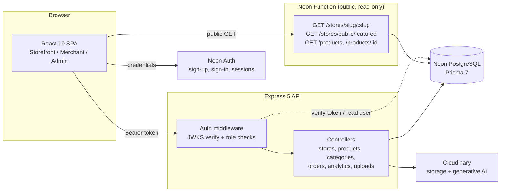
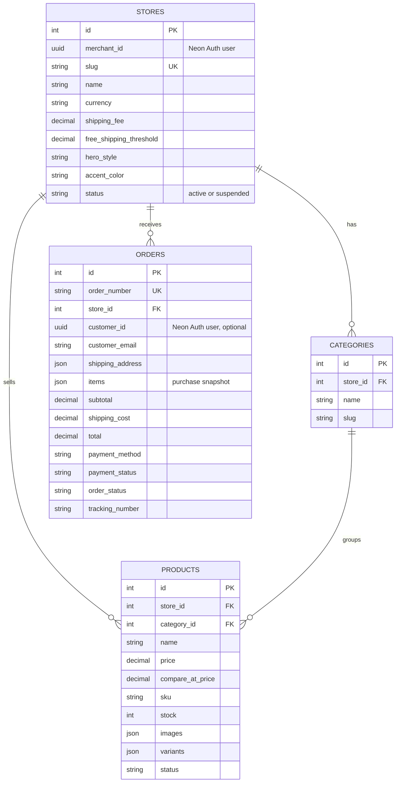

<div align="center">


# Orbivo E-Commerce Platform

**A multi-tenant, full-stack e-commerce platform where anyone can launch their own branded online store in minutes.**

Merchants get an isolated storefront, a management console, and AI-powered product photography.
Platform admins get oversight across every store. Customers get a fast, themed shopping experience.

[](https://react.dev)
[](https://www.typescriptlang.org)
[](https://nodejs.org)
[](https://expressjs.com)
[](https://neon.tech)
[](https://www.prisma.io)
[](https://tailwindcss.com)
[](https://vite.dev)
[](https://cloudinary.com)
[](https://vercel.com)
[](client/LICENSE.md)

</div>

<!--
  TODO (optional): add a live demo link and screenshots, then uncomment.

  [**Live Demo**](https://your-deployment-url.vercel.app) · [Report a Bug](https://github.com/Ayush-verma25/Orbivo-E-Commerce-Platform-App/issues) · [Request a Feature](https://github.com/Ayush-verma25/Orbivo-E-Commerce-Platform-App/issues)
-->

---

## Table of Contents

- [Overview](#overview)
- [Features](#features)
- [Tech Stack](#tech-stack)
- [System Architecture](#system-architecture)
- [Engineering Highlights](#engineering-highlights)
- [Data Model](#data-model)
- [API Reference](#api-reference)
- [Frontend Routes](#frontend-routes)
- [Project Structure](#project-structure)
- [Getting Started](#getting-started)
- [Environment Variables](#environment-variables)
- [Available Scripts](#available-scripts)
- [Deployment](#deployment)
- [Known Limitations and Roadmap](#known-limitations-and-roadmap)
- [Acknowledgements](#acknowledgements)
- [License](#license)
- [Author](#author)

---

## Overview

**Orbivo** is a multi-tenant e-commerce engine built on the **PERN stack** (PostgreSQL, Express, React, Node.js) and written end to end in **TypeScript**.

A single deployment hosts many independent stores. When a merchant registers, they receive their own storefront at `/store/<their-slug>` with a separate product catalog, categories, orders, shipping rules, and visual theme, while a platform administrator can monitor and moderate every store from one console.

The platform serves three distinct audiences:

| Role | What they do |
| :--- | :--- |
| **Customer** | Browses a store, builds a cart, checks out as a guest or a signed-in user, and tracks orders. |
| **Merchant** | Creates and brands a store, manages products, variants, inventory and categories, fulfils orders, and reads sales analytics. |
| **Platform Admin** | Sees platform-wide metrics, lists all merchants and stores, and can suspend or reactivate any store. |

---

## Features

### Customer Storefront

- **Tenant-isolated storefronts** at `/store/:storeSlug`, each with its own catalog and branding.
- **Per-store theming**: four hero layouts (`hero1` to `hero4`) and a 10-colour accent palette, applied at runtime through CSS variables with an automatic light or dark contrast text colour.
- **Catalog browsing** with search and sorting (price low to high, price high to low, name A to Z, name Z to A), with search and sort state kept in the URL.
- **Product detail pages** with an image gallery, variant selection (for example Size or Color), stock awareness, compare-at pricing, and related products.
- **Persistent per-store cart** saved in `localStorage`, with quantity caps tied to available stock and a **free-shipping progress bar**.
- **Guest or authenticated checkout** using Cash on Delivery.
- **Order confirmation and receipts** looked up by an unguessable order number, plus a signed-in **order history** page.

### Merchant Console

- **Onboarding wizard** to set store name, URL slug, description, logo, banner, currency, shipping fee, and free-shipping threshold.
- **Product management** with full CRUD, SKU, stock, compare-at price, draft or active status, multi-image upload, and a **variant builder** for option groups.
- **Category management** scoped to the merchant's own store.
- **Order management** with a fulfilment workflow, tracking numbers, and payment status updates.
- **Dashboard analytics**: revenue, order count, average order value, pending and delivered orders, product count, low-stock alerts (5 units or fewer), and the five most recent orders.
- **Branding settings** to change hero style, accent colour, shipping rules, and store identity at any time.

### AI-Powered Product Photography

Built on Cloudinary's generative AI, directly inside the product editor:

- **Generative Recolor**: describe an object (for example "jacket") and a target colour to produce a colour variant of a product photo, with an option to add that colour to the product's variants automatically.
- **Background Removal**: produce clean cut-out product shots in one click.
- **On-Model Photography (virtual try-on)**: combine a garment photo with a model photo to generate a photorealistic on-model image, with controls for garment type, pose, and background.

### Platform Administration

- **Overview metrics**: total, active, and suspended stores, merchant count, total orders, total revenue, and a **top-5 stores by revenue** leaderboard.
- **Store moderation**: activate or suspend any store. Suspended stores are blocked from the public API and from accepting new orders.
- **Merchant directory**: every registered merchant and the store linked to them.

---

## Tech Stack

| Layer | Technologies |
| :--- | :--- |
| **Frontend** | React 19, TypeScript, Vite 8, React Router 7, Tailwind CSS 4, Axios, Lucide React, React Hot Toast, Oxlint |
| **Backend** | Node.js, Express 5, TypeScript (run with `tsx`), Multer, `express-rate-limit`, `jose`, `file-type` |
| **Database** | PostgreSQL on [Neon](https://neon.tech), accessed through Prisma 7 with the `@prisma/adapter-pg` driver adapter |
| **Authentication** | Neon Auth (email and password) with JWT verification against a remote JWKS, plus a session-table fallback |
| **Serverless** | A Neon Function (`@neondatabase/serverless`) serving public, read-only storefront data |
| **Media and AI** | Cloudinary (storage, delivery optimisation, generative recolor, background removal, image-to-image generation) |
| **Hosting** | Vercel (frontend SPA and Express API) and Neon (database, auth, function) |

---

## System Architecture

The backend is deliberately split in two. Authenticated and write operations go through the **Express API**, while high-traffic **public reads** are served by a lightweight **Neon Function** that talks to the database directly. The frontend's Axios interceptor routes each request to the right service automatically.



### How request routing works

`client/src/config/api.ts` creates one Axios instance. When `VITE_NEON_FUNCTIONS_URL` is set, any `GET` to `/api/products*`, `/api/stores/slug/*`, or `/api/stores/public/featured` is redirected to the Neon Function. Everything else, including every authenticated call, goes to the Express API with an injected `Authorization: Bearer <token>` header.

> **Important:** the store-by-slug, featured-stores, and product-by-id endpoints are implemented **only** in the Neon Function, not in Express. The Neon Function is therefore required for storefront pages to load. See [Getting Started](#getting-started).

### Authentication and authorization flow

1. The user signs up or signs in through the **Neon Auth** client in the browser.
2. The session token is stored and attached to API requests as a Bearer token.
3. The Express middleware verifies the token against Neon Auth's **JWKS** endpoint (issuer and optional audience checked) using `jose`. If that fails, it falls back to a lookup in the `neon_auth.session` table.
4. The resolved user's **role** is derived: `admin` from the Neon user record, `merchant` if the user owns a store or carries the merchant role, otherwise `customer`.
5. `requireRole([...])` guards each route. Merchants are always resolved to their own store from the **token**, never from a client-supplied store ID.

### Role-based access

| Capability | Public | Customer | Merchant | Admin |
| :--- | :---: | :---: | :---: | :---: |
| Browse stores, products, categories | ✅ | ✅ | ✅ | ✅ |
| Place an order (guest or signed in) | ✅ | ✅ | ✅ | |
| View own order history | | ✅ | ✅ | |
| Create and configure own store | | ✅ (becomes merchant) | ✅ | ❌ |
| Manage products, categories, orders | | | ✅ | |
| Upload images and use AI tools | | ✅ | ✅ | ✅ |
| Merchant analytics | | | ✅ | |
| Platform analytics, suspend stores, list merchants | | | | ✅ |

---

## Engineering Highlights

These are the parts of the codebase that go beyond basic CRUD.

**Safe, race-free checkout.** Order creation runs inside a single Prisma transaction. For every cart line the server loads the product scoped to the target store, then decrements stock with a conditional update (`stock >= quantity`). If any line cannot be fulfilled, the whole transaction rolls back, so inventory can never go negative and concurrent buyers cannot oversell a product.

**Server-authoritative pricing.** The client only sends product IDs and quantities. Prices, product names, shipping cost, and totals are all recomputed on the server from database values, so a tampered cart cannot change what a customer pays. Each order also stores an immutable snapshot of the purchased items.

**Tenant isolation by construction.** Every merchant query resolves the store from the authenticated user (`stores.merchant_id`) and then constrains reads and writes by `store_id`. Category assignment on a product is verified to belong to the same store, so one merchant cannot touch another's data.

**Hardened image pipeline.** Uploads are validated by content, not by file extension:
- Files are held in memory with a 10 MB limit and a 5-file cap per batch request.
- Real file type is detected from magic bytes (`file-type`). Only JPEG, PNG, GIF, WebP, AVIF, and SVG are accepted.
- SVGs are inspected and rejected if they contain scripts, inline event handlers, `javascript:` URLs, `foreignObject`, `iframe`/`embed`/`object`, or XML entity declarations (XXE).
- Remote image URLs used by the AI tools must be **HTTPS**, may not include credentials or ports, and are checked against private, loopback, link-local, and reserved IPv4 and IPv6 ranges to prevent **SSRF**.
- AI prompts are restricted to a safe character set and colours are normalised to a validated hex or named colour before being placed into a Cloudinary transformation URL.

**Cost and abuse control.** The AI endpoints are rate limited to 10 requests per minute, keyed by user ID (falling back to IP).

**Unguessable order numbers.** Order numbers combine a base-36 timestamp with 16 cryptographically random bytes, which makes the public receipt endpoint safe to expose without authentication.

**Runtime theming without a rebuild.** A store's accent colour is converted into a set of CSS custom properties (hover, tinted backgrounds, borders, focus ring, and a YIQ-based contrast colour), so each storefront is themed instantly from a single hex value.

**Production configuration guard.** The Vite config fails the production build if `VITE_BASE_URL` is missing, is not HTTPS, or points at localhost, preventing a broken deploy that silently calls a local API.

**Edge-friendly public reads.** The public Neon Function only exposes `GET`, `HEAD`, and `OPTIONS`, returns only active products from active stores, and answers `403` for suspended stores.

---

## Data Model

Four core tables are managed by Prisma. User identities live in Neon Auth's own `neon_auth` schema and are referenced by UUID (`merchant_id`, `customer_id`).



**Lifecycles**

- Order status: `placed` → `confirmed` → `processing` → `shipped` → `delivered` (or `cancelled`)
- Payment status: `pending`, `paid`, `failed`, `refunded`
- Store status: `active` or `suspended`

Cascading deletes are configured so removing a store removes its categories, products, and orders. Indexes exist on `stores.slug`, `products.store_id`, `orders.store_id`, and `orders.order_number`.

---

## API Reference

**Base URL (local):** `http://localhost:5000`. All responses follow a `{ success, ... }` envelope.

### Express API

<details open>
<summary><b>Public and optionally authenticated</b></summary>

| Method | Endpoint | Description |
| :--- | :--- | :--- |
| `GET` | `/` | Health check |
| `GET` | `/api/products` | List products. Query: `storeId` or `storeSlug`, `categoryId` |
| `GET` | `/api/categories` | List a store's categories with product counts. Query: `storeId` or `storeSlug` (required) |
| `POST` | `/api/orders/checkout` | Place an order. Token optional, linking the order to the user if present |
| `GET` | `/api/orders/receipt/:orderIdentifier` | Fetch an order receipt by order number |
| `GET` | `/api/orders/customer/my-orders` | Signed-in customer's orders. Query: `storeSlug` or `storeId` (optional) |

</details>

<details>
<summary><b>Authenticated users (any role)</b></summary>

| Method | Endpoint | Description |
| :--- | :--- | :--- |
| `POST` | `/api/stores` | Create a store (promotes the user to merchant). Admins are rejected |
| `POST` | `/api/stores/onboard-merchant` | Elevate the current user to the merchant role |
| `GET` | `/api/stores/me` | Get the current user's store |
| `PUT` | `/api/stores/me` | Update store settings and branding |
| `POST` | `/api/upload/single` | Upload one image (field `image`) |
| `POST` | `/api/upload/multiple` | Upload up to 5 images (field `images`) |
| `POST` | `/api/upload/ai-transform` | AI recolor or background removal. Rate limited |
| `POST` | `/api/upload/ai-on-model` | AI on-model photography. Rate limited |

</details>

<details>
<summary><b>Merchant only</b></summary>

| Method | Endpoint | Description |
| :--- | :--- | :--- |
| `GET` | `/api/products/merchant` | List the merchant's products |
| `POST` | `/api/products` | Create a product |
| `PUT` | `/api/products/:id` | Update a product |
| `DELETE` | `/api/products/:id` | Delete a product |
| `POST` | `/api/categories` | Create a category |
| `DELETE` | `/api/categories/:id` | Delete a category |
| `GET` | `/api/orders/merchant` | List store orders. Query: `status` (optional) |
| `PATCH` | `/api/orders/merchant/:id/status` | Update order status, payment status, tracking number |
| `GET` | `/api/analytics/merchant` | Store analytics |

</details>

<details>
<summary><b>Platform admin only</b></summary>

| Method | Endpoint | Description |
| :--- | :--- | :--- |
| `GET` | `/api/stores/admin/all` | All stores with product count, order count, and revenue |
| `GET` | `/api/stores/admin/merchants` | All merchants and their stores |
| `PATCH` | `/api/stores/admin/:storeId/status` | Toggle a store between active and suspended |
| `GET` | `/api/analytics/platform` | Platform-wide analytics and top stores |

</details>

### Neon Function (public, read-only)

| Method | Endpoint | Description |
| :--- | :--- | :--- |
| `GET` | `/stores/public/featured` | Up to 12 newest active stores |
| `GET` | `/stores/slug/:slug` | Store details by slug (`403` if suspended, `404` if missing) |
| `GET` | `/products` | Active products for a store. Query: `storeSlug` or `storeId`, `categoryId`, `search` |
| `GET` | `/products/:id` | Active product with category and store info |
| `GET` | `/health` | Health check |

---

## Frontend Routes

| Area | Route | Access |
| :--- | :--- | :--- |
| **Platform** | `/` | Public landing page |
| **Storefront** | `/store/:storeSlug` | Public |
| | `/store/:storeSlug/products` | Public |
| | `/store/:storeSlug/products/:productId` | Public |
| | `/store/:storeSlug/cart` | Public |
| | `/store/:storeSlug/checkout` | Public |
| | `/store/:storeSlug/order-confirmation/:orderNumber` | Public |
| | `/store/:storeSlug/login` | Customer sign-in and sign-up |
| | `/store/:storeSlug/orders` | Signed-in customer |
| **Merchant** | `/merchant/login`, `/merchant/register` | Public |
| | `/merchant/store-setup` | Signed-in user without a store |
| | `/merchant`, `/merchant/products`, `/merchant/categories`, `/merchant/orders`, `/merchant/settings` | Merchant |
| **Admin** | `/admin/login` | Public (no registration) |
| | `/admin`, `/admin/stores`, `/admin/merchants` | Admin |

---

## Project Structure

```text
Orbivo-E-Commerce-Platform-App/
├── client/                          # React 19 + Vite single-page app
│   ├── public/                      # Logos, favicon, demo imagery
│   ├── src/
│   │   ├── auth.ts                  # Neon Auth client
│   │   ├── config/api.ts            # Axios instance + request-routing interceptor
│   │   ├── context/                 # AuthContext, CartContext
│   │   ├── utils/storeAccent.ts     # Accent presets + CSS-variable theming
│   │   ├── components/
│   │   │   ├── common/              # AuthCard, ProductCard, Spinner
│   │   │   ├── merchant/            # products, orders, settings (branding, shipping, hero, accent)
│   │   │   └── public/              # landing, storefront (4 heroes), product-detail, cart, checkout
│   │   └── pages/
│   │       ├── public/              # Landing, storefront, cart, checkout, customer pages
│   │       ├── merchant/            # Dashboard, products, categories, orders, settings, setup
│   │       └── admin/               # Dashboard, stores, merchants
│   ├── vercel.json                  # SPA rewrite
│   └── vite.config.ts               # Tailwind plugin + production URL guard
│
└── server/                          # Express 5 + Prisma 7 API
    ├── server.ts                    # App entry, middleware, route mounting
    ├── routes/                      # analytics, categories, orders, products, stores, uploads
    ├── controllers/                 # Business logic for each resource
    ├── middleware/
    │   ├── auth.ts                  # JWKS verification, optionalAuth, requireAuth, requireRole
    │   └── upload.ts                # Multer config + content validation
    ├── services/neonUser.ts         # Queries against the neon_auth schema
    ├── utils/imageValidation.ts     # Magic-byte checks, SVG sanitising, SSRF guard
    ├── config/                      # Prisma client (pg adapter), Cloudinary
    ├── functions/index.ts           # Neon Function: public read-only API
    ├── neon.ts                      # Neon Function definition (dev port 8787)
    ├── prisma/                      # schema.prisma + SQL migrations
    ├── prisma7.config.ts            # Prisma CLI configuration
    └── vercel.json                  # Vercel Node deployment config
```

---

## Getting Started

### Prerequisites

- **Node.js** `^20.19.0` or `>=22.12.0` (required by Vite 8) and **npm** 9+
- A **[Neon](https://neon.tech)** project with **Neon Auth** enabled
- A **[Cloudinary](https://cloudinary.com)** account (the AI features depend on the corresponding Cloudinary AI add-ons being available on your plan)

> The setup steps below are derived from reading the source code. If a command differs on your machine, the [Environment Variables](#environment-variables) table is the source of truth for configuration.

### 1. Clone the repository

```bash
git clone https://github.com/Ayush-verma25/Orbivo-E-Commerce-Platform-App.git
cd Orbivo-E-Commerce-Platform-App
```

### 2. Set up the backend

```bash
cd server
npm install        # also runs `prisma generate` via the postinstall script
```

Create `server/.env` (see [Environment Variables](#environment-variables)), then apply the database migration:

```bash
npx prisma migrate deploy --config prisma7.config.ts
```

> **Tip:** Prisma migrations on Neon work best over the **direct (unpooled)** connection string. Because `prisma7.config.ts` reads `DATABASE_URL`, point it at the direct URL while migrating, then switch back to the pooled URL for the running app.

Start the API:

```bash
npm run server     # nodemon + tsx, http://localhost:5000
```

### 3. Provide the public Neon Function

The storefront loads store and product data through the Neon Function defined in `server/neon.ts` and `server/functions/index.ts` (local dev port `8787`). Run or deploy it with Neon's tooling, then note its base URL for the next step. It needs the same `DATABASE_URL` configured.

### 4. Set up the frontend

```bash
cd ../client
npm install
```

Create `client/.env` (see below), then:

```bash
npm run dev        # http://localhost:5173
```

### 5. Create a platform admin

There is intentionally no public admin registration. Sign up a normal account through the app, then promote it in your Neon SQL editor:

```sql
UPDATE neon_auth."user"
SET role = 'admin'
WHERE email = 'you@example.com';
```

You can then sign in at `/admin/login`. Admin accounts cannot create stores or act as merchants.

### 6. Try the merchant flow

1. Visit `/merchant/register` and create an account.
2. Complete the **store setup** wizard.
3. Add categories and products from the merchant console.
4. Open `/store/<your-slug>` in another tab, add items to the cart, and check out.

---

## Environment Variables

### Server (`server/.env`)

| Variable | Required | Description |
| :--- | :---: | :--- |
| `DATABASE_URL` | ✅ | Neon PostgreSQL connection string used by Prisma and the Neon Function |
| `NEON_AUTH_JWKS_URL` | ✅ | Neon Auth JWKS endpoint used to verify JWTs |
| `NEON_AUTH_BASE_URL` | ✅ | Neon Auth base URL, used as the expected token issuer |
| `NEON_AUTH_AUDIENCE` | | Expected token audience, validated when set |
| `CLOUDINARY_CLOUD_NAME` | ✅ | Cloudinary cloud name (the server throws on startup if missing) |
| `CLOUDINARY_API_KEY` | ✅ | Cloudinary API key |
| `CLOUDINARY_API_SECRET` | ✅ | Cloudinary API secret |
| `PORT` | | API port, defaults to `5000` |

### Client (`client/.env`)

| Variable | Required | Description |
| :--- | :---: | :--- |
| `VITE_BASE_URL` | ✅ in production | Express API base URL. Defaults to `http://localhost:5000` in development. Production builds fail if it is missing or not an HTTPS, non-localhost URL |
| `VITE_NEON_AUTH_URL` | ✅ | Neon Auth endpoint for the browser auth client |
| `VITE_NEON_FUNCTIONS_URL` | ✅ | Base URL of the deployed Neon Function that serves public reads |

> **Never commit real secrets.** `server/.env` is git-ignored. Note that `VITE_*` values are embedded in the browser bundle, so they must never contain secrets.

---

## Available Scripts

### Server

| Command | Description |
| :--- | :--- |
| `npm run server` | Start the API in watch mode (`nodemon` + `tsx`) |
| `npm start` | Start the API once with `tsx` |
| `npm run build` | Compile TypeScript to `dist/` |

### Client

| Command | Description |
| :--- | :--- |
| `npm run dev` | Start the Vite dev server with HMR |
| `npm run build` | Type-check with `tsc -b`, then build the production bundle |
| `npm run preview` | Preview the production build locally |
| `npm run lint` | Run Oxlint |

---

## Deployment

The project is set up for a split deployment:

- **Frontend**: deploy `client/` to **Vercel**. `client/vercel.json` rewrites every path to the SPA entry so client-side routing works. Set `VITE_BASE_URL`, `VITE_NEON_AUTH_URL`, and `VITE_NEON_FUNCTIONS_URL` in the build environment, because Vite inlines them at build time.
- **API**: deploy `server/` to **Vercel** using `@vercel/node` (configured in `server/vercel.json`). Provide all server environment variables in the project settings.
- **Database, auth, and public function**: hosted on **Neon**.

---

## Known Limitations and Roadmap

Being transparent about what is and is not implemented yet:

**Current limitations**

- Payments are **Cash on Delivery only**. Payment status is updated manually by the merchant.
- The `coupon_code` and `discount` fields exist in the schema, but checkout does not apply discounts yet.
- Merchants can create categories and assign products to them, and the API supports filtering by `categoryId`, but the storefront UI does not expose a category filter yet.
- Product reviews and storefront testimonials are **static sample content**, not user-generated.
- There is no automated test suite yet.
- Product lists are not paginated.
- Several internal identifiers still use earlier working names (for example the `Cartiva` prefix on `localStorage` keys and Cloudinary folders).

**Roadmap ideas**

- [ ] Online payments (Stripe or Razorpay) alongside COD
- [ ] Coupon and discount engine using the existing schema fields
- [ ] Real customer reviews and ratings with moderation
- [ ] Transactional emails (order confirmation, shipping updates)
- [ ] Category filter on the storefront catalog (the API already supports it)
- [ ] Pagination and server-side search for large catalogs
- [ ] Unit and integration tests, plus CI
- [ ] Restrict CORS to known origins
- [ ] Custom domains per store

---

## Acknowledgements

The React frontend builds on **StoreiFly**, an open-source multi-tenant storefront project by GreatStack and contributors, distributed under the MIT License. The original license and copyright notice are preserved in [`client/LICENSE.md`](client/LICENSE.md). This repository extends it with the Neon-backed Express and Prisma API layer, the Neon Function for public reads, hardened upload and AI image pipelines, and the platform administration features described above.

Built with [Neon](https://neon.tech), [Prisma](https://www.prisma.io), [Cloudinary](https://cloudinary.com), [Vercel](https://vercel.com), [Lucide](https://lucide.dev), and [React Hot Toast](https://react-hot-toast.com).

---

## License

Distributed under the **MIT License**. See [`client/LICENSE.md`](client/LICENSE.md) for details.

---

## Author

**Ayush Verma**

[](https://github.com/Ayush-verma25)

<div align="center">

If you found this project useful or interesting, consider giving it a ⭐

</div>
